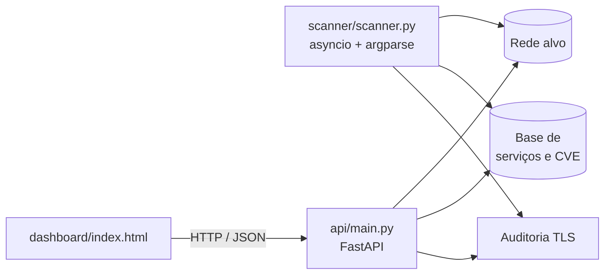

# SENTINEL — Security Monitoring & Threat Intelligence Platform

Plataforma de reconhecimento e auditoria de superfície de ataque, com API REST, scanner assíncrono de linha de comando e dashboard de visualização.

Executa descoberta de portas TCP, auditoria de certificados TLS, classificação de risco por serviço exposto e geração de relatório estruturado — o suficiente para alimentar um fluxo de avaliação autorizada de rede.

[](https://www.python.org/)
[](https://fastapi.tiangolo.com/)
[](LICENSE)
[](https://sentinel-sec.vercel.app/)
[](https://sentinel-api.onrender.com)

**Dashboard:** https://sentinel-sec.vercel.app/ · **API:** https://sentinel-api.onrender.com · **OpenAPI:** https://sentinel-api.onrender.com/api/docs

> A instância da API roda no tier gratuito do Render, que suspende o serviço após inatividade. A primeira requisição após a suspensão leva de 30 a 60 segundos — comportamento esperado, não indisponibilidade.

---

## Sumário

- [Escopo](#escopo)
- [Arquitetura](#arquitetura)
- [Estrutura do projeto](#estrutura-do-projeto)
- [Instalação](#instalação)
- [Uso](#uso)
- [API](#api)
- [Base de conhecimento de portas](#base-de-conhecimento-de-portas)
- [O que é funcional e o que é demonstração](#o-que-é-funcional-e-o-que-é-demonstração)
- [Hardening pendente](#hardening-pendente)
- [Deploy](#deploy)
- [Testes e integração contínua](#testes-e-integração-contínua)
- [Roadmap](#roadmap)
- [Uso autorizado](#uso-autorizado)
- [Autor](#autor)
- [Licença](#licença)

---

## Escopo

O projeto cobre quatro capacidades, todas apoiadas num único núcleo de varredura:

| Capacidade | Implementação | Estado |
| --- | --- | --- |
| Descoberta de portas TCP | `socket.connect_ex` (API) e `asyncio.open_connection` (CLI) | Funcional |
| Auditoria de certificado TLS | `ssl.create_default_context` com leitura de validade, emissor e expiração | Funcional |
| Classificação de exposição | Base de serviços por porta com severidade, CVE e remediação | Funcional |
| Relatório estruturado | JSON com achados, duração, score e nível de risco agregado | Funcional |

O dashboard consome a API e apresenta os resultados; seus painéis agregados usam valores de demonstração. A [seção dedicada](#o-que-é-funcional-e-o-que-é-demonstração) detalha a fronteira.

---

## Arquitetura



Três componentes, dois serviços em produção. `dashboard/` é estático e hospedado no Vercel; `api/` roda no Render e concentra a lógica de rede. `scanner/` compartilha o mesmo desenho de varredura, em versão de linha de comando com relatório em disco — útil para execução agendada em pipeline de reconhecimento.

O núcleo de varredura está duplicado entre `api/main.py` e `scanner/scanner.py`. A unificação num pacote `sentinel_core/` está no roadmap e é a refatoração de maior impacto estrutural pendente.

---

## Estrutura do projeto

Legenda: `[x]` presente no repositório · `[ ]` planejado

```
sentinel-SEC/
├── [x] README.md
├── [x] .gitignore
├── [x] LICENSE                   # MIT
├── [x] requirements.txt          # dependências do projeto
├── [x] render.yaml               # definição de serviço no Render
├── [x] vercel.json               # publicação estática no Vercel
├── [x] railway.json              # definição de serviço no Railway
├── [x] Procfile                  # comando de start da API
├── [x] nixpacks.toml             # configuração de build
├── [x] runtime.txt               # versão do Python em produção
├── [ ] .github/
│   └── [ ] workflows/
│       └── [ ] ci.yml            # lint, import check e validação do OpenAPI
├── api/
│   ├── [x] main.py               # aplicação FastAPI
│   ├── [ ] security.py           # CORS restrito, API key e rate limit
│   └── [x] requirements.txt      # dependências da API
├── scanner/
│   └── [x] scanner.py            # CLI assíncrono com relatório JSON
├── dashboard/
│   └── [x] index.html            # dashboard
└── [ ] docs/
    └── [ ] ARQUITETURA.md        # decisões de projeto e fluxo de dados
```

Três arquivos de deploy coexistem na raiz — `render.yaml`, `vercel.json` e `railway.json` —, o que dá três caminhos de publicação. Os dois primeiros estão em uso; `railway.json` fica como alternativa documentada.

---

## Instalação

Requer **Python 3.10+** (uso de `list[int]` e `X | None` em anotações) e Git.

```bash
git clone https://github.com/gaugustoo/sentinel-SEC.git
cd sentinel-SEC

python -m venv .venv
source .venv/bin/activate        # Linux / macOS
.venv\Scripts\activate           # Windows

pip install -r requirements.txt
```

Para contribuir, instale também o linter:

```bash
pip install ruff
ruff check api scanner
```

---

## Uso

### API

```bash
uvicorn api.main:app --reload --port 8000
```

Sobe em `http://localhost:8000`. Documentação gerada pelo FastAPI:

- **Swagger UI** — http://localhost:8000/api/docs
- **ReDoc** — http://localhost:8000/api/redoc
- **Especificação OpenAPI** — http://localhost:8000/openapi.json

### Scanner CLI

```bash
# Conjunto padrão de 20 portas
python scanner/scanner.py --target 192.168.1.1

# Portas específicas
python scanner/scanner.py --target 10.0.0.5 --ports 22 80 443 3306

# Timeout reduzido e relatório em caminho definido
python scanner/scanner.py --target 172.16.0.10 --timeout 2 --output recon/172.16.0.10.json
```

| Argumento | Obrigatório | Padrão | Descrição |
| --- | --- | --- | --- |
| `--target` | sim | — | IP ou hostname alvo |
| `--ports` | não | 20 portas de exposição comum | Lista de portas separadas por espaço |
| `--timeout` | não | `1.5` | Timeout por porta, em segundos |
| `--output` | não | `scan_<alvo>_<timestamp>.json` | Caminho do relatório JSON |

A saída traz, por porta aberta, serviço identificado, severidade, CVE associado quando houver e a recomendação de remediação, além do score agregado de risco no fim da execução.

---

## API

Base local `http://localhost:8000` · base em produção `https://sentinel-api.onrender.com`

| Método | Rota | Descrição |
| --- | --- | --- |
| `GET` | `/` | Status do serviço e versão |
| `POST` | `/api/scan/ports` | Varredura de portas TCP no alvo informado |
| `GET` | `/api/scan/ssl` | Auditoria do certificado TLS de um hostname |
| `GET` | `/api/threats/ioc` | Consulta de IoC na base interna de threat intelligence |
| `GET` | `/api/vulnerabilities` | Lista as vulnerabilidades conhecidas, filtrável por severidade |
| `GET` | `/api/dashboard/stats` | Estatísticas do dashboard — agregações geradas a cada chamada |
| `GET` | `/api/report/generate` | Relatório executivo de segurança para o alvo |

### `POST /api/scan/ports`

Corpo aceito, conforme o modelo `ScanTarget`:

| Campo | Tipo | Obrigatório | Padrão | Restrições |
| --- | --- | --- | --- | --- |
| `target` | string | sim | — | IP válido ou hostname resolvível |
| `ports` | inteiros | não | `[21, 22, 23, 25, 80, 443, 3306, 5432, 8080]` | Portas individuais por requisição |
| `timeout` | float | não | `2.0` | Entre `0.5` e `10.0` segundos |

O alvo é validado com `ipaddress.ip_address` e, na falha, com resolução via `socket.gethostbyname` — entrada inválida retorna HTTP 400 antes de qualquer conexão. O `risk_level` da resposta é derivado da severidade mais alta entre as portas abertas: `CRITICAL`, `HIGH`, `MEDIUM`, `LOW` ou `SAFE` quando nada responde.

```bash
curl -X POST https://sentinel-api.onrender.com/api/scan/ports \
  -H "Content-Type: application/json" \
  -d '{
    "target": "example.com",
    "ports": [21, 22, 80, 443, 3306],
    "timeout": 2.0
  }'
```

```json
{
  "target": "example.com",
  "open_ports": [
    {
      "port": 80,
      "service": "HTTP",
      "severity": "low",
      "cve": null,
      "description": "Tráfego HTTP não criptografado."
    }
  ],
  "scan_duration": 1.24,
  "risk_level": "LOW",
  "timestamp": "2026-10-13T16:11:13"
}
```

### `GET /api/scan/ssl`

```bash
curl "https://sentinel-api.onrender.com/api/scan/ssl?hostname=example.com"
```

Retorna validade, data de expiração, dias restantes, emissor, versão de protocolo, nível de risco e a lista de problemas encontrados.

### `GET /`

```bash
curl https://sentinel-api.onrender.com/
```

```json
{
  "service": "SENTINEL Security Platform",
  "version": "1.0.0",
  "status": "operational"
}
```

---

## Base de conhecimento de portas

Cada porta aberta é confrontada com uma tabela de serviços que carrega severidade, descrição, CVE quando aplicável e recomendação de correção. Trecho da base:

| Porta | Serviço | Severidade | CVE | Remediação |
| --- | --- | --- | --- | --- |
| 21 | FTP | HIGH | CVE-2023-1234 | Migre para SFTP ou FTPS |
| 23 | Telnet | CRITICAL | CVE-2022-5678 | Desabilite e migre para SSH |
| 445 | SMB | CRITICAL | CVE-2017-0144 | Aplique MS17-010, desabilite SMBv1 |
| 1433 | MSSQL | CRITICAL | — | Restrinja ao localhost e aplique firewall |
| 3306 | MySQL | CRITICAL | CVE-2023-9999 | Restrinja à rede interna |
| 3389 | RDP | HIGH | CVE-2019-0708 | VPN obrigatória antes do RDP |
| 5432 | PostgreSQL | CRITICAL | — | Restrinja via `pg_hba.conf` |
| 5900 | VNC | HIGH | — | Acesso por VPN com autenticação forte |
| 6379 | Redis | CRITICAL | CVE-2022-0543 | Configure `requirepass` e bind em localhost |

> **Os identificadores CVE são ilustrativos.** Servem para demonstrar a estrutura do achado e do relatório; não foram validados contra o NVD. Antes de usar a classificação como referência, substitua-os por identificadores verificados — ou remova o campo e mantenha apenas severidade e remediação, que são corretas.

### Divergência conhecida entre as duas bases

`api/main.py` e `scanner/scanner.py` mantêm tabelas independentes, e elas **já divergem**: a porta 21 é `high` na API e `critical` no CLI, e a cobertura não é a mesma (a API parte de 9 portas, o CLI de 20). O mesmo alvo pode receber classificações diferentes conforme o ponto de entrada. A correção é o módulo compartilhado `sentinel_core/` descrito no roadmap.

---

## O que é funcional e o que é demonstração

| Componente | Estado | Observação |
| --- | --- | --- |
| Varredura de portas (API e CLI) | **Funcional** | Abre conexões TCP reais; reporta apenas portas que responderam |
| Auditoria TLS | **Funcional** | Handshake real, leitura do certificado e cálculo de expiração |
| Classificação de severidade | **Funcional** | Aplicada sobre o resultado efetivamente obtido |
| Relatório JSON e score de risco | **Funcional** | Derivados dos achados da execução |
| Agregados e feed do dashboard | **Demonstração** | Valores estáticos na interface, sem coleta em segundo plano |
| Top Threat IPs do dashboard | **Demonstração** | Lista fixa; os endereços são exemplos e blocos reservados para documentação |
| `/api/threats/ioc` | **Demonstração** | Consulta uma lista fixa de cinco IPs em memória; não há base externa de threat intelligence |
| `/api/vulnerabilities` | **Funcional** | Lê a base interna de portas do próprio código; sem dado externo |
| `/api/dashboard/stats` | **Misto** | A rota é real e responde, mas os agregados são gerados por `random` a cada chamada |

A fronteira é deliberada e está registrada aqui para que ninguém dimensione o projeto por engano — nem para cima, nem para baixo. O núcleo faz trabalho de rede real; a camada visual é demonstração e se identifica como tal na própria interface.

---

## Hardening pendente

Itens levantados na revisão do próprio código, em ordem de prioridade. **Enquanto o primeiro não for resolvido, a API pública não deve permanecer no ar.**

| # | Item | Situação | Ação | Estado |
| --- | --- | --- | --- | --- |
| 1 | **CORS** | `allow_origins=["*"]` com todos os métodos e headers | Restringir à origem do dashboard via variável de ambiente | Aplicado em `main.py` |
| 2 | **Autenticação** | Ausente | Chave de API obrigatória nos endpoints de varredura | Aplicado em `main.py` |
| 3 | **Rate limiting** | Ausente | Limite por IP, com janela deslizante | Aplicado em `main.py` |
| 4 | **Autorização de alvo** | Apenas validação de formato | Bloquear faixas que não pertencem ao operador | Pendente |
| 5 | **Divergência das bases** | Porta 21 classificada de forma diferente na API e no CLI | Unificar em `sentinel_core/` | Pendente |
| 6 | **Tratamento de exceções** | `except Exception: pass` engole falha de socket | Logar em nível debug e contabilizar por porta | Pendente |

Os itens 1, 2 e 3 estão implementados em `api/security.py` e registrados em `api/main.py` — `install_cors` substitui o middleware anterior e as rotas `POST /api/scan/ports` e `GET /api/scan/ssl` encadeiam `Depends(rate_limit)` e `Depends(verify_api_key)`.

Duas variáveis de ambiente do Render condicionam o efeito:

| Variável | Sem ela |
| --- | --- |
| `SENTINEL_ALLOWED_ORIGINS` | CORS cai no padrão de desenvolvimento (localhost) e o dashboard deixa de conseguir chamar a API |
| `SENTINEL_API_KEY` | A autenticação fica desligada e a API permanece aberta para qualquer origem |

O risco combinado de 1, 2 e 3 é concreto: sem a chave definida, qualquer origem na internet pode disparar varreduras a partir da infraestrutura do projeto. Isso desloca a responsabilidade legal do atacante para o operador da API.

Configuração pretendida, já suportada por `security.py`:

```bash
# .env — nunca versionado
SENTINEL_ALLOWED_ORIGINS=https://sentinel-sec.vercel.app
SENTINEL_API_KEY=<chave-gerada>
```

---

## Deploy

Três arquivos de configuração coexistem na raiz. Os serviços em uso hoje:

| Alvo | Arquivo | Estado |
| --- | --- | --- |
| API | `render.yaml`, `Procfile`, `nixpacks.toml`, `runtime.txt` | Ativo |
| Dashboard | `vercel.json` | Ativo |
| API (alternativa) | `railway.json` | Não utilizado |

### API — Render

`render.yaml` descreve o serviço; com o repositório conectado, cada push na `main` dispara deploy.

```yaml
services:
  - type: web
    name: sentinel-api
    runtime: python
    buildCommand: pip install -r requirements.txt
    startCommand: uvicorn api.main:app --host 0.0.0.0 --port $PORT
```

### Dashboard — Vercel

`vercel.json` publica `dashboard/` como site estático. Importar o repositório no Vercel é suficiente; não há configuração adicional.

### Variáveis de ambiente

| Variável | Obrigatória | Finalidade |
| --- | --- | --- |
| `SENTINEL_ALLOWED_ORIGINS` | sim (após o hardening) | Origens autorizadas no CORS |
| `SENTINEL_API_KEY` | sim (após o hardening) | Chave exigida nos endpoints de varredura |
| `SENTINEL_RATE_WINDOW` | não (`60`) | Janela do rate limit, em segundos |
| `SENTINEL_RATE_MAX` | não (`30`) | Requisições por janela, por IP |
| `SENTINEL_RATE_DISABLED` | não | `1` desliga o rate limit em desenvolvimento e no CI |

---

## Testes e integração contínua

O workflow em `.github/workflows/ci.yml` roda em cada push e pull request contra `main`, em Python 3.10, 3.11 e 3.12:

1. Verificação de sintaxe e importação de `api/` e `scanner/`
2. Lint com Ruff
3. Subida da API e validação do health check
4. Leitura do `openapi.json` e conferência de que as rotas foram documentadas

> O workflow **ainda não está no repositório**. Enquanto não for adicionado, o GitHub sugere configurações prontas de Python na aba Actions — vale usar o workflow versionado, que roda as quatro etapas acima em vez de um lint isolado.

```bash
# Mesmas verificações, localmente
python -m compileall -q api scanner
ruff check api scanner
uvicorn api.main:app --port 8000 &
curl -sf http://localhost:8000/ && echo "OK"
```

Os testes automatizados de comportamento (varredura contra alvo controlado, parsing do relatório, derivação do score) ainda não existem — estão no roadmap. O CI atual garante que a aplicação importa, sobe e documenta suas rotas, que é o piso mínimo.

---

## Roadmap

- [ ] Adicionar `api/security.py` ao repositório e registrá-lo em `api/main.py`
- [ ] Adicionar `.github/workflows/ci.yml` ao repositório
- [ ] Adicionar `docs/ARQUITETURA.md` ao repositório
- [ ] Extrair `sentinel_core/` com o motor de varredura, a base de serviços e o modelo de risco, eliminando a duplicação entre API e CLI
- [ ] Substituir os CVE ilustrativos por identificadores verificados ou remover o campo
- [ ] Suíte de testes com `pytest` e alvo controlado em container
- [ ] Descoberta de hosts por faixa CIDR, em vez de alvo único
- [ ] Identificação de serviço por banner grabbing, substituindo a inferência por porta
- [ ] Exportação de relatório em SARIF e Markdown para integração em pipeline
- [ ] Capturas de tela do dashboard neste README

---

## Uso autorizado

Varredura apenas em sistemas próprios ou com **autorização escrita prévia** do responsável. O acesso não autorizado a sistema informatizado é crime no Brasil — Lei 12.737/2012, art. 154-A do Código Penal — e é tipificado em praticamente todas as jurisdições relevantes.

A ferramenta foi construída para laboratório próprio, ambiente de teste autorizado e estudo de segurança. O autor não se responsabiliza pelo uso indevido nem por danos decorrentes dele.

---

## Autor

**Guilherme Augusto** — Cybersecurity · SOC · Pentesting · Security QA

[](https://www.linkedin.com/in/guilherme-augusto-966824234)

Contribuidor: **362514Gui** — correção da configuração de deploy no Vercel.

---

## Licença

MIT. Consulte [LICENSE](LICENSE).
